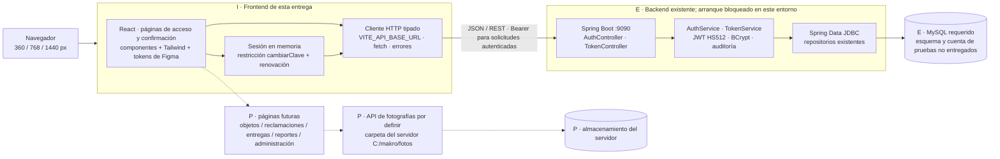

# Arquitectura — primera entrega

Sistema Web de Gestión de Objetos Perdidos — Makro Chincha. Airton, Developer 1 — Frontend. Corte: 18/10/2026; presentación: lunes 19/10/2026. Método: Scrum Adaptativo.

## Evidencia y decisiones

La tecnología del Frontend está definida por el equipo: **React + TypeScript + Vite + Tailwind CSS**. Se conservaron los servicios tipados, recursos, tokens y pruebas útiles del avance interrumpido y se adaptó la interfaz a componentes React. No se desarrollaron los módulos posteriores.

El Backend inspeccionado es `technologycenter1/objetos-personales`, rama `master`, commit `ded2115cb0c645f4c64f6ad771759f2e6627db2b`, descargado del [repositorio compartido](https://bitbucket.org/technologycenter1/objetos-personales/commits/branch/master). Su README es la plantilla de Bitbucket; el contrato se obtuvo de controllers, DTO, servicios, filtros y repositorios. No contiene Frontend. Detalles y límites: [inspección e integración](04-backend-integracion.md).

| Elemento | Situación comprobada |
|---|---|
| React 19.3.1, TypeScript 7.0.2, Vite 8.3.4, Tailwind 4.3.3 | Implementados en esta entrega; versiones fijadas en package-lock.json |
| Java 17 como objetivo, Spring Boot 3.5.13 | Existentes en pom.xml; compilados con JDK 21.0.12.1 disponible |
| REST, Spring Data JDBC, MySQL Connector/J | Existentes en código; conexión a MySQL bloqueada por falta de ambiente |
| JWT HS512, refresh token, BCrypt coste 10 | Existentes en JwtTokenComponent, TokenService y SecurityConfig; no son solo una propuesta del diagrama |
| Fotografías en carpeta del servidor | Propuesta del equipo; solo límites multipart de 5/6 MB comprobados. No hay controller de fotografías ni publicación HTTP de esa carpeta en este commit |
| Objetos, reclamaciones, verificación, entregas, reportes | Diseñados en Figma y planificados; sin implementación Frontend en esta entrega ni controllers encontrados en este Backend |

## Diagrama de componentes y límites

Las flechas describen responsabilidades e interfaces. **No afirman que haya una sesión real verificada.** El fallo observado está al arrancar el Backend, antes de completar navegador → API → MySQL. [Abrir diagrama SVG independiente](diagrama-arquitectura.svg).



**E:** existe en código o es dependencia requerida por ese código. **I:** implementado en esta entrega. **P:** propuesta/trabajo posterior. MySQL no se ejecutó y no se inspeccionó su esquema real. Las fotografías solo podrán llegar al navegador mediante una URL HTTP(S) devuelta por una API futura, con permisos definidos. `C:\makro\fotos` no es una URL de imagen, no aparece en el código del Frontend y no habilita acceso directo a disco.

## Organización del Frontend

```text
src/
  main.tsx                  # arranque React, fuentes locales y estilos
  App.tsx                   # flujo mínimo y sesión; rutas hash protegidas
  pages/
    LoginPage.tsx           # único formulario conectado
    SessionPage.tsx         # confirmación mínima y salida de la sesión
  components/
    BrandHeader.tsx         # logo original y sede
    FormField.tsx           # etiqueta, control, error accesible
    Button.tsx              # variantes primary/secondary
  services/
    http.ts                 # fetch, timeout, validación del sobre y errores
    auth.ts                 # login, refresh, logout; AuthSession tipado
    session.ts              # lectura de exp para programar renovación
  config.ts                 # configuración pública por ambiente
  styles/
    tokens.css              # colores, tipografía y medidas de Figma
    tailwind.css            # Tailwind, tema y estilos reutilizables
public/assets/              # logo e iconos descargados de Figma, sin URL temporal
tests/                      # contrato con transporte aislado + navegador real
docs/                       # entregables, evidencias y decisiones pendientes
```

A futuro, cada módulo incorporará su página en `pages/`, componentes específicos bajo su carpeta y un servicio por dominio. No se crearon carpetas vacías ni pantallas ficticias para aparentar esos módulos. No se necesita un router adicional para las tres ubicaciones del flujo mínimo.

## Navegación y sesión

- `#/acceso`: formulario público. El acceso directo a otra ubicación sin sesión vuelve aquí.
- La función pendiente Recuperar acceso muestra una alerta con el texto «En proceso»; la aplicación no navega a Figma.
- `#/sesion`: confirmación con `names` y `role` de la respuesta real; no existe selector de roles ni dashboard simulado.
- `#/cambio-requerido`: misma confirmación restringida si `cambiarClave=true`; no habilita otro módulo. El formulario de cambio es trabajo posterior y dependencia explícita para esas cuentas.
- Los tokens permanecen en memoria de la pestaña, sin localStorage, sessionStorage ni cookies. Recargar vuelve al acceso. React escapa los textos de la API.
- La renovación usa el `refreshToken` y `username` de la API. Se programa con `exp` del JWT; esa lectura no valida la firma ni concede permisos. El servidor decide validez y autorización. No se interpreta la fecha `expireTimeToken`, que no incluye zona horaria.
- Si falla la renovación, se limpia la sesión y se solicita acceso. Una renovación que termina después de salir no puede restaurar la sesión anterior.
- Cancelar el diálogo de salida conserva la sesión. Confirmar llama a logout y limpia la memoria. Si no se puede confirmar la revocación remota, se informa expresamente. El código del Backend revoca el refresh token; no se comprobó una lista de revocación de access tokens, por lo que no se afirma revocación inmediata del JWT.

La restricción de interfaz complementa `PermisoInterceptor`; no reemplaza la autorización del Backend. No hay reglas Frontend que asignen permisos a Asistente o Auxiliar por su nombre.

## Diseño, validaciones y estados

Los componentes se derivan del contexto real de FP-01 en Figma: Roboto, azul `#0036b3`, amarillo `#fff200`, fondo `#f5f7fb`, texto `#172b4d`, borde `#dce3ed`, tarjeta máxima de 480 px con radio 16 px, campos/botones de al menos 46 px, radio 8 px y separación 20 px. A 360 px la tarjeta mide 320 px; a 768 y 1440 mide 480 px. El formulario se adapta al ancho disponible; no usa posiciones absolutas del diseño.

| Estado | Comportamiento y evidencia |
|---|---|
| Inicial/vacío | Campos vacíos, etiquetas y autocomplete; sin credenciales ni datos de demostración precargados |
| Validación | Usuario y contraseña obligatorios; error junto al campo, aria-invalid y foco en el primero inválido; no se envía solicitud |
| Carga | `Ingresando…`, botón deshabilitado, aria-busy y controles de solo lectura; bloqueo de doble envío |
| Credenciales inválidas | Mensaje genérico, también ante HTTP 200 con isSuccess=false; implementado y probado de forma aislada; prueba real bloqueada |
| Fallo de conexión/timeout | Mensaje comprensible, posibilidad de reintento y limpieza de contraseña; fallo de conexión comprobado en navegador |
| Éxito | Solo se acepta sobre exitoso, sesión completa y JWT con exp vigente. Nombre y rol proceden de API; prueba real bloqueada |
| Listas vacías futuras | Propuesto: mensaje sin resultados, filtros conservados y acción de limpiar filtros; sin tablas o servicios implementados ahora |

## Ambientes y responsabilidades

`VITE_API_BASE_URL` es el origen de la API, sin `/api`, porque las rutas de los servicios ya lo contienen. Desarrollo apunta por defecto a `http://localhost:9090`; Vite escucha en `http://127.0.0.1:5173`. Producción requiere la URL HTTPS real y compilación para ese ambiente. Las variables VITE son públicas. La contraseña de MySQL, secreto JWT, credenciales SMTP y rutas privadas de servidor pertenecen exclusivamente al Backend.

| Responsable | Responsabilidad |
|---|---|
| Airton — Developer 1 | Componentes responsive, validaciones de experiencia, consumo de API, sesión de interfaz, mensajes y evidencias Frontend |
| Compañero — Developer 2 | Ejecución Spring Boot, esquema/datos MySQL, autenticación y permisos efectivos, auditoría, CORS, contrato y futura API de fotografías |
| María — Product Owner | Prioridades oficiales, reglas y matriz de permisos pendientes, alcance y aceptación funcional |
| Patricia — evaluación/QA | Reevaluación de prototipos y validación de evidencias; revisión interna no equivale a su aprobación |

La estructura implementada está lista para recibir el ambiente real. La conexión exitosa, los permisos efectivos en base de datos y el almacenamiento de fotos permanecen **bloqueados/no comprobados**; no se presentan como arquitectura desplegada.
